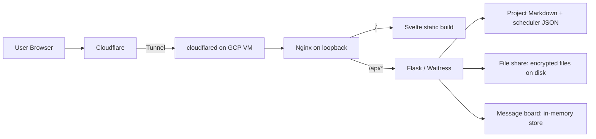
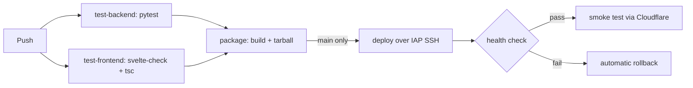

## Overview

This project is a full-stack personal website platform built as an engineering sandbox and portfolio vehicle.

It goes beyond static pages by combining:

- a typed Svelte 5 frontend with a small custom router and client-side rendering,
- a Flask backend with API endpoints for project content and utilities,
- infrastructure-as-code on Google Cloud with Terraform, reachable only through a Cloudflare Tunnel,
- a GitHub Actions pipeline that tests every push and deploys `main` with automatic rollback,
- runtime-rendered Markdown project content decoupled from frontend builds,
- and multiple interactive utilities that exercise different problem domains.

The repository serves as one cohesive system where I can design features, iterate on architecture, ship infrastructure changes, and maintain documentation, all in one place.

A key architectural decision was replacing hardcoded project content with API-backed Markdown. Write-ups are edited as files, not as frontend code, so the site behaves like a lightweight content platform rather than a static build artifact.

## Why I Built It

I wanted one repository that could serve several goals at once:

1. Present my work as a portfolio.
2. Demonstrate practical full-stack architecture decisions.
3. Host non-trivial interactive tools that exercise data modeling, security, and UI logic.

I also wanted the project to be inexpensive to operate and easy to reason about end-to-end. That drove the choice of a single small VM with clear responsibilities:

- Cloudflare for DNS, TLS, and edge proxying through a tunnel,
- Nginx for static hosting, security headers, and rate limiting,
- Flask for APIs and content,
- Svelte static output for frontend delivery,
- GitHub Actions for testing and releases.

Another goal was technical transparency. I wanted to be able to answer detailed questions such as:

- How is project content modeled and delivered?
- How is scheduler data validated?
- How does a commit get from GitHub to the running service, and what happens if it's broken?
- What are the known risks and next architecture improvements?

This write-up is intentionally detailed so it can work as both a portfolio explanation and an engineering handoff document.

## Architecture

### Request Lifecycle

All traffic enters through Cloudflare, which forwards it over an outbound-only tunnel to the VM. From there, requests follow two paths:

1. Page/navigation requests are served by Nginx from the Svelte build, with SPA fallback to `index.html`.
2. Data requests under `/api/*` are proxied by Nginx to Flask on `127.0.0.1:5000`.

For project detail pages, the browser loads the SPA route, then fetches project content from the API. Markdown is transformed and rendered client-side.

For utilities, the scheduler's logic runs entirely in the browser, while File Share and Message Board keep their state on the backend.

This split keeps backend logic simple while still enabling complex interaction in the UI.

### Frontend

- Svelte 5 (runes) + TypeScript + Vite
- A small History API router written in-house, replacing page.js
- Shared fetch helpers and UI components used by every page
- Runtime project rendering pipeline:
  - fetch Markdown from the backend API
  - parse, transform, and sanitize with unified/remark/rehype
  - render Mermaid diagrams client-side, matching the site theme

#### Frontend Responsibilities

- Route rendering and navigation state
- Loading/error states for API-backed pages
- Utility-specific interaction models and state
- Theme persistence and the global visual system

#### Routing

The router strips trailing slashes, matches a single route table, and exposes reactive `path`, `route`, and `params` state. It intercepts clicks on same-origin links, so pages use plain `<a href>` elements. The route table also drives the nav's active state and the 404 page, which suggests the closest real route by Levenshtein distance.

I replaced page.js with this router to drop a dependency and keep routing behavior small enough to fully understand.

#### Shared Code

A recent refactor consolidated duplicated logic across pages and removed roughly 1,500 lines net:

- `lib/api.ts`: `apiFetch`/`apiJson` helpers that surface the backend's `{ error }` messages and reject unexpected non-JSON responses. Every feature's API client builds on them.
- `PageHeader`, `StatusMessage`, and `TagList` components for consistent page structure and loading/error display.
- A theme store that persists the light/dark choice and lets project pages re-render Mermaid diagrams when it changes.
- A scheduler catalog module shared by the initial load and JSON import, so both paths validate schedules the same way.

#### Markdown Rendering Pipeline

Project detail pages use a pipeline that supports:

- GFM features such as lists, tables, and task syntax,
- heading slug generation and anchor links,
- sanitization before injecting HTML,
- Mermaid code-fence transformation and runtime rendering.

This enables rich technical write-ups without trusting raw HTML from content files.

#### Frontend Tradeoffs

I intentionally moved logic toward the client for responsiveness and lower backend complexity. The downside is higher UI complexity and more care needed around lifecycle timing, graph recomputation, and safe HTML rendering.

### Backend

- Flask application factory + a single blueprint
- Waitress in production; CORS enabled only in development
- Separate modules for file-share storage/encryption and message-board logic
- A `/api/health/` endpoint used by deploys and smoke tests
- pytest suite with coverage, using a temporary instance directory per test

#### Backend Responsibilities

- Serve scheduler data files as JSON
- Parse project Markdown frontmatter and return API payloads
- Filter unpublished projects and sort by priority
- Store, encrypt, and expire shared files
- Sanitize, rate-limit, and expire message-board posts
- Return consistent JSON errors (`{"error": "..."}`) for the frontend to display

#### Project Content Contract

Each project file includes frontmatter metadata:

- title, slug, summary
- priority (higher sorts first)
- tags
- repo and optional demo URL
- published flag

The backend exposes:

1. `/api/projects/` for listing published metadata
2. `/api/projects/<slug>/` for detail payloads including the Markdown body

This keeps content's source of truth in versioned Markdown while preserving API-level structure for the frontend.

#### Backend Tradeoffs

The backend is intentionally lightweight. Most transformation and presentation logic happens in the frontend. This keeps the Python code concise, but limits server-side control over final rendering.

### Infrastructure

- Terraform-managed GCP network, firewall, and e2-micro VM (Debian 12)
- Cloudflare DNS, Tunnel, and a Managed Transform for visitor location headers
- Nginx on loopback for static hosting, security headers, and rate limiting
- systemd services for the backend and `cloudflared`
- Google Secret Manager for runtime secrets

#### Network Model

The VM has no open web ports. `cloudflared` dials out to Cloudflare, and Nginx and Flask listen only on `127.0.0.1`. The only inbound firewall rule allows SSH from Google's IAP range. That means:

- the origin can't be reached directly, so every request passes through Cloudflare's WAF and rate-limit rules,
- there's no origin certificate to manage,
- Cloudflare-set headers such as `CF-Connecting-IP` can be trusted for rate limiting and the About You page.

#### Deployment Pipeline

Provisioning and releases are separate. Terraform builds the VM rarely; GitHub Actions ships code on every push to `main`.

1. Pull requests and pushes run backend tests and frontend type checks.
2. On `main`, CI builds the frontend, exports hash-pinned backend requirements from `uv.lock`, and packages a release tarball.
3. The deploy job authenticates with Workload Identity Federation (no stored keys) and streams the tarball to the VM over IAP SSH.
4. On the VM, the deployer's only sudo right is a deploy script. It verifies the checksum, builds a venv from hash-pinned wheels, swaps the `current` symlink atomically, and restarts the service.
5. If `/api/health/` doesn't come up within about 30 seconds, the script switches back to the previous release and fails the workflow.

The newest five releases stay on disk, so rolling back is one command. Actions are pinned to commit SHAs.

#### Hardening

- Releases are root-owned and read-only to the app user.
- The Flask service runs under systemd sandboxing (`ProtectSystem=strict`, `PrivateTmp`, `NoNewPrivileges`) and can write only its data directory.
- Secrets are fetched from Secret Manager at boot, never templated through Terraform.
- Nginx sets HSTS and other security headers, caps body sizes, and rate-limits per visitor IP.

#### Monitoring

Better Stack monitors uptime externally, and a public status page is linked from the site's nav bar.

#### Operational Benefits

- Low hosting cost
- Few moving parts
- Fast debugging thanks to a clear runtime topology
- Safe, repeatable deploys with automatic rollback

#### Operational Risks

- Single failure domain
- Terraform state still lives locally rather than in a remote, encrypted backend
- Less elasticity than managed multi-service environments

## Utilities

The platform hosts several interactive utilities that showcase different engineering challenges:

- **Class Scheduler** (`/utilities/scheduler`): semester-based drag-and-drop planning with prerequisite validation, a dependency graph, variable-credit courses, auto-detangling of graph edges, and JSON import/export.
- **File Share** (`/utilities/fileshare`): temporary file sharing under an access key. Files are encrypted at rest (scrypt + AES-256-GCM), looked up by an HMAC of the key, limited to 100 MB each and 1 GB total, and expire after 10 minutes.
- **Message Board** (`/utilities/message-board`): an anonymous board where posts expire 30 seconds after posting, with allowlist sanitization, a 280-character limit, and per-IP rate limiting.

There's also an **About You** page that shows what the site can observe about a visit: request headers, Cloudflare's location headers, browser properties, and in-session navigation history (kept in memory, never sent to the server).

Each utility is self-contained under its own route, with frontend logic in `frontend/src/lib/<utility>/` and backend endpoints under `/api/<utility>/`. Adding one means adding a route-table entry, a page, an API client built on the shared helpers, and backend routes with tests. Utility data models, API contracts, and limits are documented in `documentation/UTILITIES.md`.

## Dynamic Project Content System

A core architectural decision was replacing hardcoded project cards and details with API-backed Markdown content.

### Why This Matters

Before this change, editing a project write-up meant changing frontend source code and rebuilding the SPA.

Now content is decoupled from frontend code:

1. Edit a Markdown file in the backend content directory.
2. Check the API response (`/api/projects/<slug>/`). Flask rereads files on every request, so local edits show up immediately.
3. Push to `main`; the pipeline tests and deploys it.

This workflow dramatically reduces editorial friction.

### Technical Implementation

Content flow:

1. Project files live in `backend/app/content/projects/` as Markdown with YAML frontmatter.
2. `/api/projects/` returns published metadata, sorted by priority, for card/index views.
3. `/api/projects/<slug>/` returns full metadata plus the Markdown body.
4. The frontend fetches, parses, and renders at runtime.

The rendering pipeline:

1. Parse Markdown with GitHub Flavored Markdown (GFM) support.
2. Generate anchor IDs for headings and inject links.
3. Convert Mermaid code fences into placeholder targets.
4. Sanitize HTML to prevent injection attacks.
5. Mount DOM content.
6. Run Mermaid rendering for diagrams, using the current theme.

### Reliability Lessons

Implementing this surfaced subtle integration issues:

- The sanitization schema needed explicit support for Mermaid container tags to preserve diagram placeholders.
- Mermaid has to run after rendered content is mounted, and again when the theme changes.
- Instrumenting each stage (input validation, parse, sanitize, render) was essential for debugging.

Those lessons are now encoded in the implementation.

## Challenges and Tradeoffs

### 1) Simplicity vs scalability

A single VM keeps operations straightforward, but it concentrates failure risk. File-share and message-board state live on one disk and in one process, which rules out horizontal scaling.

### 2) Rich client behavior vs complexity

The scheduler computes everything in-browser for responsiveness, which increases frontend state management and complexity.

### 3) Fast content publishing vs rendering surface area

Runtime Markdown rendering speeds publishing, but requires careful sanitization and renderer maintenance.

### 4) Security vs convenience

The tunnel-only network, keyless CI credentials, and a single-purpose sudo rule make the deployment much harder to abuse, but they add setup steps and make debugging access more deliberate.

### 5) Full-stack breadth vs maintenance cost

Owning the frontend, backend, infrastructure, and pipeline in one repo improves learning and control, but increases maintenance burden. Clear docs, shared code, and conventions keep it sustainable.

### 6) Debugging the pipeline

Moving deploys to GitHub Actions surfaced a non-obvious stall: from the runner, the end of the release tarball reached the VM exactly 240 seconds late (two of sshd's 120-second keepalive intervals), while the same transfer took about three seconds locally. Client-side SSH keepalives every five seconds push the stalled data through, bringing deploys back to normal speed.

## Portfolio Value

This project demonstrates full-stack architecture in a cohesive, deployable system:

**Frontend Architecture**: Route-driven SPA design with a custom router, shared API and UI primitives, state management across multiple utilities, safe HTML rendering, and runtime Markdown parsing with diagram support.

**Backend Design**: API-first thinking, frontmatter-based content modeling, encryption and expiry for user uploads, input sanitization and rate limiting, and a tested API surface.

**Infrastructure as Code**: A tunnel-only VM topology, deterministic first-boot provisioning, runtime secret retrieval, and least-privilege service configuration.

**CI/CD**: Tested, reproducible releases with hash-pinned dependencies, keyless authentication, atomic activation, and automatic rollback.

**Content Platform**: Decoupling content from frontend code, a practical pattern for portfolio sites, blogs, documentation, and product platforms.

**Integration**: Connecting frontend, backend, infrastructure, and delivery into a working system that can be deployed, iterated on, and understood end-to-end.

The project prioritizes clarity and coherence over feature breadth. Every component has a clear responsibility, making it straightforward to follow a request from the browser to the running service.

## Results

- One cohesive repository demonstrating frontend, backend, infrastructure, and CI/CD capability.
- Push-to-deploy releases with tests as a gate and automatic rollback on failed health checks.
- Multiple interactive utilities showcasing different problem domains and interaction patterns.
- A content platform where write-ups are published by editing Markdown.
- Public uptime monitoring and a status page.
- Documentation covering architecture, implementation, deployment, operations, and known issues.

## Performance and Operational Notes

The architecture emphasizes predictable behavior over aggressive optimization.

Observed strengths:

- simple request path,
- low coordination overhead,
- fast local iteration with a single `start-dev.sh` script.

Current constraints:

- no horizontal scaling strategy,
- the file share holds whole files in memory during transfer, so it caps concurrent transfers at two on a 1 GB VM,
- scheduler edits live only in browser memory unless exported.

These are acceptable for the current scope and are tracked as known issues.

## Security and Trust Model

Key practices in the current implementation:

- no open web ports: all traffic arrives through the Cloudflare Tunnel
- HTTPS enforced by Cloudflare, plus an Nginx redirect and HSTS
- CORS enabled only in development; production is same-origin
- Markdown sanitized before HTML injection; message-board text allowlist-filtered and rendered as plain text
- file-share downloads always served as `application/octet-stream` with `nosniff`
- secrets fetched from Secret Manager at boot
- deploy credentials issued only to `main` in the `production` environment through Workload Identity Federation
- releases verified by checksum, with hash-pinned dependencies

Areas to strengthen:

- enforce the Content Security Policy (currently report-only)
- move Terraform state to an encrypted remote backend
- optionally gate production deploys behind a required reviewer

## What I Would Improve Next

1. Add frontend tests, starting with the scheduler's parser and graph logic.
2. Wire the home page's featured projects to `/api/projects/` instead of placeholder content.
3. Add saved schedule persistence (local first, then optional backend storage).
4. Stream file-share encryption in fixed-size chunks to keep memory flat and allow more concurrent transfers.
5. Move Terraform state to a remote encrypted backend and bring the status-page DNS record under Terraform.
6. Expand write-ups with screenshots and deeper implementation notes per project.
