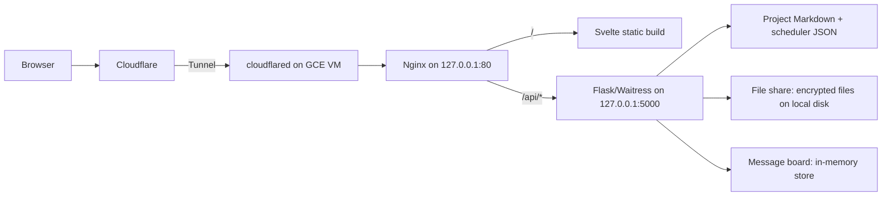

# Architecture

## Goals

1. Present a public portfolio and project write-ups.
2. Host multiple interactive utilities on a shared platform.
3. Keep operations simple and low-cost (one small VM).
4. Update project content without rebuilding the frontend (write-ups are Markdown served by the backend).

## System Topology

## Stack

| Layer | Components |
| --- | --- |
| Frontend | Svelte 5, TypeScript, Vite, custom History API router, unified/remark/rehype Markdown pipeline, Mermaid |
| Backend | Flask app factory + one blueprint, Waitress in production, Flask-CORS (development only), `cryptography` for file-share encryption |
| Infrastructure | Terraform, GCE e2-micro (Debian 12), Nginx, systemd, Cloudflare DNS + Tunnel + Managed Transforms, Google Secret Manager |

## Repository Layout

- `frontend/`: SPA, router, page components, per-utility logic in `src/lib/<utility>/`.
- `backend/`: Flask app (`app/`), project Markdown (`app/content/projects/`), scheduler data (`app/static/json/`), tests.
- `deployment/`: Terraform, VM startup script, systemd and Nginx templates.
- `documentation/`: these docs.
- `start-dev.sh`: runs backend and frontend together for local development.

## Runtime Flows

**Navigation.** The router maps the URL to a page component; pages that need data fetch it on mount and switch among loading, error, and ready states. Unknown paths render a 404 page with a closest-match suggestion.

**Utilities.** Each utility page calls its `/api/<utility>/` endpoints. Scheduler logic (prerequisite validation, graph layout) runs entirely in the browser; File Share and Message Board state lives on the backend. Details: [Utilities](./UTILITIES.md).

**Project content.**

1. `Projects.svelte` fetches `/api/projects/` (published metadata, sorted by `priority`).
2. `ProjectDetail.svelte` fetches `/api/projects/<slug>/` (metadata + Markdown body).
3. The Markdown is rendered client-side (GFM, heading anchors, sanitization), then Mermaid blocks are drawn.

The backend reads the Markdown files on every request, so editing a file changes the site without a rebuild or restart.

## Security and Trust Boundaries

1. **No open web ports.** All traffic arrives through the Cloudflare Tunnel; Nginx and Flask listen only on loopback. Cloudflare-set headers (`CF-Connecting-IP`, visitor location headers) are therefore trustworthy.
2. **HTTPS** is enforced by Cloudflare plus an Nginx redirect and HSTS. Nginx also sets security headers and rate-limits per visitor IP (CSP is currently report-only).
3. **CORS** is enabled only when `FLASK_ENV=development`; production is same-origin.
4. **Untrusted content.** Project Markdown is sanitized before injection; message-board text is allowlist-filtered and rendered as plain text; file-share downloads are always served as `application/octet-stream`.
5. **Secrets** are fetched from Secret Manager by the VM at boot, never templated into Terraform output.

## Tradeoffs

1. A single VM is simple and cheap but is a single failure domain.
2. Runtime Markdown allows content-only updates at the cost of client-side rendering complexity.
3. In-browser utility logic keeps interactions fast at the cost of a heavier client.
4. File-share and message-board state is local to one process/disk, which rules out horizontal scaling.

Open issues are tracked in [Runbook → Known Issues](./RUNBOOK.md#known-issues).
