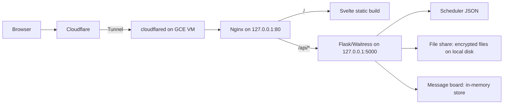

# Architecture

## Goals

1. Present a public portfolio and project write-ups.
2. Host multiple interactive utilities on a shared platform.
3. Keep operations simple and low-cost (one small VM).
4. Keep project write-ups as Markdown files, rendered to HTML at build time.

## System Topology

## Stack

| Layer | Components |
| --- | --- |
| Frontend | Svelte 5, TypeScript, Vite, custom History API router, unified/remark/rehype Markdown pipeline (build time), Mermaid |
| Backend | Flask app factory + one blueprint, Waitress in production, Flask-CORS (development only), `cryptography` for file-share encryption |
| Infrastructure | Terraform, GCE e2-micro (Debian 12), Nginx, systemd, Cloudflare DNS + Tunnel + Managed Transforms, Google Secret Manager |
| CI/CD | GitHub Actions (test, package, deploy over IAP SSH with Workload Identity Federation) |

## Repository Layout

- `frontend/`: SPA, router, page components, per-utility logic in `src/lib/<utility>/`, project Markdown (`src/content/projects/`), build-time Vite plugins (`plugins/`).
- `backend/`: Flask app (`app/`), scheduler data (`app/static/json/`), tests.
- `deployment/`: Terraform, VM startup script, release deploy script, systemd and Nginx templates.
- `.github/workflows/test.yaml`: tests PRs and pushes to `main`. Docs-only pushes skip it.
- `.github/workflows/deploy.yaml`: run by hand on `main`; builds a release and deploys it without rerunning the tests.
- `documentation/`: these docs.
- `start-dev.sh`: runs backend and frontend together for local development.
- `deploy.sh`: dispatches the Deploy workflow on `main` and follows the run.
- `test.sh`: runs every local check (backend tests, frontend unit tests, check, and build, browser smoke test and a11y scan).

## Runtime Flows

**Navigation.** The router maps the URL to a page component; pages that need data fetch it on mount and switch among loading, error, and ready states. Unknown paths, including project slugs that don't exist, render a 404 page with a closest-match suggestion.

**Utilities.** Each utility page calls its `/api/<utility>/` endpoints. Scheduler logic (prerequisite validation, graph layout) runs entirely in the browser; File Share and Message Board state lives on the backend. Details: [Utilities](./UTILITIES.md).

**Project content.**

1. At build time, `frontend/plugins/projects.ts` reads `src/content/projects/*.md`, drops unpublished ones, sorts by `priority`, and renders each to sanitized HTML (GFM, heading anchors, Mermaid placeholders).
2. `Projects.svelte` lists the metadata, which is in the main bundle. `ProjectDetail.svelte` loads that project's HTML chunk, injects it, then draws Mermaid blocks. Mermaid is loaded on demand, only for write-ups that contain a diagram.

No API call is involved. The dev server reloads the page when a write-up changes; in production, content ships with the next deploy.

## Security and Trust Boundaries

1. **No open web ports.** All traffic arrives through the Cloudflare Tunnel; Nginx and Flask listen only on loopback. Cloudflare-set headers (`CF-Connecting-IP`, visitor location headers) are therefore trustworthy.
2. **HTTPS** is enforced by Cloudflare plus an Nginx redirect and HSTS. Nginx also sets security headers and rate-limits `/api/` per visitor IP, returning `429` (CSP is currently report-only).
3. **CORS** is enabled only when `FLASK_ENV=development`; production is same-origin.
4. **Untrusted content.** Project Markdown is sanitized at build time before it's injected; message-board text is allowlist-filtered and rendered as plain text; file-share downloads are always served as `application/octet-stream`.
5. **Secrets** are fetched from Secret Manager by the VM at boot, never templated into Terraform output.
6. **Deploys.** Only GitHub Actions jobs on `main` in the `production` environment can get credentials, through Workload Identity Federation (no stored keys). The deployer can reach the VM only over IAP SSH as a non-admin OS Login user. Its one root action is the deploy script, which checks the release checksum and installs only hash-pinned wheels.
7. **Least privilege on the VM.** Releases are root-owned and read-only to `flaskapp`, which runs under systemd sandboxing and can write only `/var/lib/personalwebsite`.

## Tradeoffs

1. A single VM is simple and cheap but is a single failure domain.
2. Runtime Markdown allows content-only updates at the cost of client-side rendering complexity.
3. In-browser utility logic keeps interactions fast at the cost of a heavier client.
4. File-share and message-board state is local to one process/disk, which rules out horizontal scaling.

Open issues are tracked in [Issues](./ISSUES.md).
