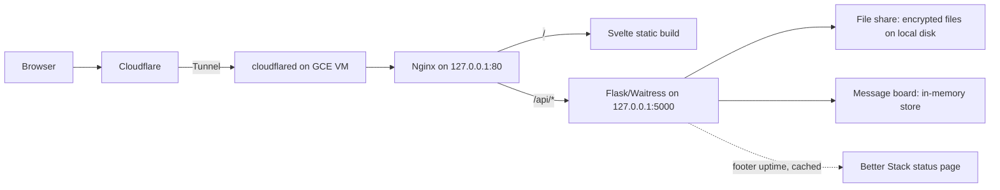

# Architecture

## Goals

1. Present a public portfolio and project write-ups (Markdown, rendered at build time).
2. Host interactive utilities on a shared platform.
3. Keep operations simple and cheap: one small VM.

## System Topology

## Stack

| Layer | Components |
| --- | --- |
| Frontend | Svelte 5, TypeScript, Vite, custom History API router, unified/remark/rehype Markdown pipeline with KaTeX math (build time), Mermaid |
| Backend | Flask app factory + one blueprint, Waitress in production, Flask-CORS (development only), `cryptography` for file-share encryption |
| Infrastructure | Terraform, GCE e2-micro (Debian 13), Nginx, systemd, Cloudflare DNS + Tunnel + Managed Transforms, Google Secret Manager, Cloud Storage (release bucket) |
| CI/CD | GitHub Actions (test; manual package + deploy over IAP SSH with Workload Identity Federation) |

## Repository Layout

- `frontend/`: SPA, page components, per-utility logic in `src/lib/<utility>/`, site content in `src/content/` (project Markdown, scheduler data), build-time Vite plugins in `plugins/`.
- `backend/`: Flask app (`app/`), tests.
- `infrastructure/`: Terraform and the VM startup script. `infrastructure/vm/` holds the files the script installs: the release deploy script, systemd units, Nginx config, sudoers rule, apt, sysctl and rsyslog settings, and the guest agent config.
- `.github/workflows/`: `test.yaml` ([Development](./DEVELOPMENT.md#ci)) and the manual `deploy.yaml` ([Infrastructure](./INFRASTRUCTURE.md#deploy-workflow)).
- `documentation/`: these docs.
- Root scripts: `start-dev.sh`, `test.sh`, `format.sh`, `doc-test.sh`, `gen-icons.sh`, `deploy.sh` ([Development](./DEVELOPMENT.md#scripts)).

## Runtime Flows

- **Navigation.** The router maps the URL to a page; pages that need data fetch it on mount. Unknown paths, including unknown project slugs, render a 404 page with a closest-match suggestion. The interactive shell navigates through the same router.
- **Utilities.** The Scheduler runs entirely in the browser, on data that ships with the build. File Share and Message Board call their `/api/<utility>/` endpoints, and their state lives on the backend ([Utilities](./UTILITIES.md)).
- **Project content.** Write-ups are rendered to sanitized HTML at build time and loaded per project as a JS chunk; no API call is involved, so content ships with the next deploy ([Implementation](./IMPLEMENTATION.md#project-rendering)).

## Security and Trust Boundaries

1. **No open web ports.** All traffic arrives through the Cloudflare Tunnel; Nginx and Flask listen only on loopback. Cloudflare-set headers (`CF-Connecting-IP`, visitor location headers) are therefore trustworthy.
2. **HTTPS** is enforced by Cloudflare plus an Nginx redirect and HSTS. Nginx also sets security headers and rate-limits `/api/` per visitor IP ([details](./INFRASTRUCTURE.md#runtime-on-the-vm); CSP is currently report-only).
3. **CORS** is enabled only when `FLASK_ENV=development`; production is same-origin.
4. **Untrusted content.** Project Markdown is sanitized at build time; message-board text has control and invisible characters stripped and is rendered as plain text; file-share downloads are always `application/octet-stream`.
5. **Secrets** are fetched from Secret Manager by the VM at boot, never templated into Terraform output ([Secrets](./INFRASTRUCTURE.md#secrets)).
6. **Deploys.** Only GitHub Actions jobs on `main` in the `production` environment can get credentials, through Workload Identity Federation (no stored keys). The deployer reaches the VM only over IAP SSH as a non-admin OS Login user whose one root action is a deploy script that accepts only app code and hash-pinned wheels ([details](./INFRASTRUCTURE.md#releases)). Only the deployer can write the release bucket that new VMs install from.
7. **Outbound calls.** The only one the backend makes is to the public Better Stack status page (`/api/site-info/`), with no credentials. Its result is cached, so visitors can't make the VM call out per request.
8. **Least privilege on the VM.** Releases are root-owned and read-only to `flaskapp`, which runs sandboxed, can write only `/var/lib/personalwebsite`, and is firewalled from the metadata server and so from the VM's credentials ([details](./INFRASTRUCTURE.md#runtime-on-the-vm)).

## Tradeoffs

1. A single VM is simple and cheap but is a single failure domain. Planned replacements are zero-downtime [swaps](./INFRASTRUCTURE.md#vm-swaps), but a crash takes the site down until the VM recovers.
2. Build-time Markdown keeps pages fast and free of runtime sanitizing, but content changes need a deploy.
3. In-browser utility logic keeps interactions fast at the cost of a heavier client.
4. File-share and message-board state is local to one process/disk, which rules out horizontal scaling.
