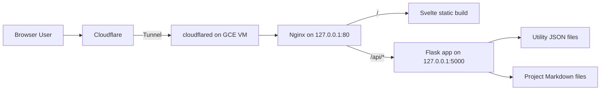

# Architecture

## Project Snapshot

This repository is a full-stack personal website with:

- a Svelte + Vite frontend,
- a Flask backend API,
- Terraform-managed deployment on a single GCP VM behind Cloudflare,
- a utilities area for interactive tools.

A major architectural improvement moved project write-ups to backend-hosted Markdown so project content can be updated without rebuilding frontend assets.

## Goals

1. Present a clear, public portfolio and project narrative.
2. Support multiple utilities under a shared site platform.
3. Keep operations simple and low-cost.
4. Support content-only updates without frontend rebuild/redeploy.

## System Topology

## Stack by Layer

### Frontend

- Svelte 5
- TypeScript
- Vite
- page.js client-side router

Responsibilities:

1. Render site routes and page content.
2. Host utility experiences under `/utilities/*` routes.
3. Fetch and render runtime Markdown project content.

### Backend

- Flask app factory + blueprint routing
- Flask-CORS scoped to `/api/*`, enabled only in development (production is same-origin)
- Waitress in production

Responsibilities:

1. Serve project and utility APIs.
2. Serve published project metadata and Markdown body content.
3. Enforce required environment configuration (`SECRET_KEY`).

### Infrastructure

- Terraform for network/VM/firewall/DNS/tunnel resources
- Nginx for static hosting, API proxying, and security headers
- systemd-managed Flask and `cloudflared` services
- Cloudflare DNS + proxy + Tunnel (TLS terminates at Cloudflare)

## Repository Layout

- `frontend/`: SPA shell, router, utility logic, project rendering pipeline.
- `backend/`: API routes, utility/project data, project content files.
- `deployment/`: Terraform and startup/service templates.
- `documentation/`: architecture, implementation, deployment, and runbook docs.

## Core Runtime Flows

### Page Navigation

1. Router maps URL to page component.
2. Data-heavy routes (utility/project detail) trigger async loads.
3. Components switch among loading, error, and ready states.

### Utility Flow

1. Frontend loads utility-specific data and state based on the route.
2. Utility logic runs in-browser for responsive interactions.
3. UI updates utility cards, controls, and visual overlays.
4. Utility-specific details and contracts are documented in `UTILITIES.md`.

### Project Content Flow

1. Frontend fetches `/api/projects` for card/index content.
2. Detail route fetches `/api/projects/:slug` for Markdown payload.
3. Renderer applies GFM parsing, heading anchors, and sanitization.
4. Mermaid diagrams render client-side after DOM update.

## Data and Content Strategy

### Utility Data

- Utility datasets and contracts are versioned per utility.
- Frontend consumes utility data on demand via API.
- Utility-specific persistence support is documented per utility.

### Project Write-Ups

- Source of truth is Markdown with YAML frontmatter in backend content directory.
- `published` frontmatter controls public visibility.
- Enables rapid editorial iteration without rebuilding frontend.

Ordering and metadata notes:

- Projects use an internal numeric `priority` frontmatter field to control list ordering. Higher `priority` values appear earlier in the `/api/projects` results. `priority` is read by the backend for ordering but is not returned in API responses to the frontend.

## Security and Trust Boundaries

1. The origin has no open web ports: all traffic arrives through the Cloudflare Tunnel, and Nginx
   and Flask listen only on loopback. Cloudflare-set headers (`CF-Connecting-IP`, location headers)
   can therefore be trusted.
2. CORS is enabled only in development, for `/api/*` routes.
3. Markdown output is sanitized before frontend injection.
4. Infra secrets are pulled from Secret Manager during provisioning.
5. HTTPS is enforced at Cloudflare and with an Nginx redirect plus HSTS. Nginx also sets security headers
   (CSP currently report-only).

## Notable Tradeoffs

1. Single VM simplicity vs managed-service scalability.
2. Runtime Markdown flexibility vs additional client rendering complexity.
3. Frontend-heavy utility logic for responsive UX vs increased client complexity.

## Constraints

1. Single-VM topology is a single failure domain.
2. Some utility datasets may be static and drift without a refresh workflow.
3. Utility persistence/auth is not yet standardized across tools.
4. Test coverage is limited across backend and frontend.

## Next Iterations

1. Add `/api/health` and basic uptime monitoring.
2. Add backend and frontend automated tests for critical flows.
3. Introduce a shared persistence pattern for applicable utilities.
4. Improve Terraform state/secrets posture for production hardening.
