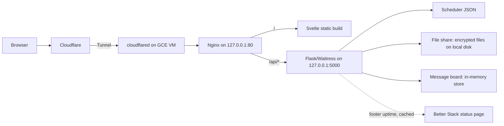

# Architecture

## Goals

1. Present a public portfolio and project write-ups (Markdown, rendered at build time).
2. Host interactive utilities on a shared platform.
3. Keep operations simple and cheap: one small VM.

## System Topology

## Stack

| Layer | Components |
| --- | --- |
| Frontend | Svelte 5, TypeScript, Vite, custom History API router, unified/remark/rehype Markdown pipeline with KaTeX math (build time), Mermaid |
| Backend | Flask app factory + one blueprint, Waitress in production, Flask-CORS (development only), `cryptography` for file-share encryption |
| Infrastructure | Terraform, GCE e2-micro (Debian 12), Nginx, systemd, Cloudflare DNS + Tunnel + Managed Transforms, Google Secret Manager, Cloud Storage (release bucket) |
| CI/CD | GitHub Actions (test; manual package + deploy over IAP SSH with Workload Identity Federation) |

## Repository Layout

- `frontend/`: SPA, page components, per-utility logic in `src/lib/<utility>/`, project Markdown in `src/content/projects/`, build-time Vite plugins in `plugins/`.
- `backend/`: Flask app (`app/`), scheduler data (`app/static/json/`), tests.
- `deployment/`: Terraform, VM startup script, release deploy script, systemd and Nginx templates.
- `.github/workflows/`: `test.yaml` and the manual `deploy.yaml` ([Deployment](./DEPLOYMENT.md#deploying-changes)).
- Root scripts: `start-dev.sh`, `test.sh`, `format.sh`, `gen-icons.sh`, `deploy.sh` ([Implementation](./IMPLEMENTATION.md)).

## Runtime Flows

- **Navigation.** The router maps the URL to a page; pages that need data fetch it on mount. Unknown paths, including unknown project slugs, render a 404 page with a closest-match suggestion. The interactive shell navigates through the same router.
- **Utilities.** Each utility page calls its `/api/<utility>/` endpoints. Scheduler logic runs entirely in the browser; File Share and Message Board state lives on the backend ([Utilities](./UTILITIES.md)).
- **Project content.** Write-ups are rendered to sanitized HTML at build time and loaded per project as a JS chunk; no API call is involved, so content ships with the next deploy ([Implementation](./IMPLEMENTATION.md#project-rendering)).

## Security and Trust Boundaries

1. **No open web ports.** All traffic arrives through the Cloudflare Tunnel; Nginx and Flask listen only on loopback. Cloudflare-set headers (`CF-Connecting-IP`, visitor location headers) are therefore trustworthy.
2. **HTTPS** is enforced by Cloudflare plus an Nginx redirect and HSTS. Nginx also sets security headers and rate-limits `/api/` per visitor IP (CSP is currently report-only).
3. **CORS** is enabled only when `FLASK_ENV=development`; production is same-origin.
4. **Untrusted content.** Project Markdown is sanitized at build time; message-board text has control and invisible characters stripped and is rendered as plain text; file-share downloads are always `application/octet-stream`.
5. **Secrets** are fetched from Secret Manager by the VM at boot, never templated into Terraform output.
6. **Deploys.** Only GitHub Actions jobs on `main` in the `production` environment can get credentials, through Workload Identity Federation (no stored keys). The deployer reaches the VM only over IAP SSH as a non-admin OS Login user; its one root action is the deploy script, which checks the release checksum and installs only hash-pinned wheels. After a passing smoke test it also writes the release to a private Cloud Storage bucket that only it can write and only the VM can read.
7. **Outbound calls.** The only one the backend makes is to the public Better Stack status page (`/api/site-info/`), with no credentials. Its result is cached, so visitors can't make the VM call out per request.
8. **Least privilege on the VM.** Releases are root-owned and read-only to `flaskapp`, which runs under systemd sandboxing and can write only `/var/lib/personalwebsite`.

## Tradeoffs

1. A single VM is simple and cheap but is a single failure domain.
2. Build-time Markdown keeps pages fast and free of runtime sanitizing, but content changes need a deploy.
3. In-browser utility logic keeps interactions fast at the cost of a heavier client.
4. File-share and message-board state is local to one process/disk, which rules out horizontal scaling.
