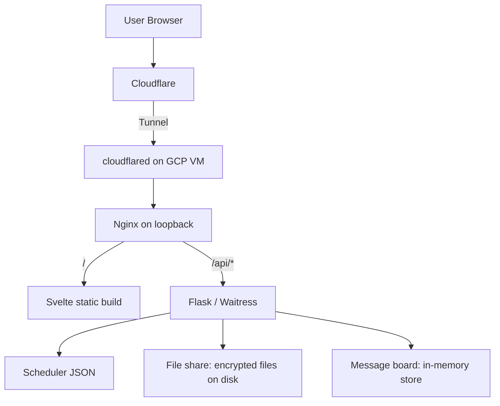
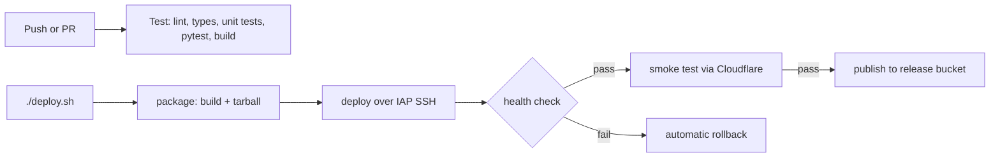

## Overview

This project is a full-stack personal website platform built as an engineering sandbox and portfolio vehicle.

It goes beyond static pages by combining:

- a typed Svelte 5 frontend with a small custom router and per-route HTML generated at build time,
- a Flask backend with API endpoints for the interactive utilities,
- infrastructure-as-code on Google Cloud with Terraform, reachable only through a Cloudflare Tunnel,
- a GitHub Actions pipeline that tests every push, plus a one-command deploy with automatic rollback,
- Markdown project write-ups rendered to HTML at build time,
- and multiple interactive utilities that exercise different problem domains.

The repository serves as one cohesive system where I can design features, iterate on architecture, ship infrastructure changes, and maintain documentation, all in one place.

A key architectural decision was replacing hardcoded project content with Markdown files. Write-ups are edited as content, not as frontend code, and a Vite plugin turns them into pre-rendered HTML during the build.

## Why I Built It

I wanted one repository that could serve several goals at once:

1. Present my work as a portfolio.
2. Demonstrate practical full-stack architecture decisions.
3. Host non-trivial interactive tools that exercise data modeling, security, and UI logic.

I also wanted the project to be inexpensive to operate and easy to reason about end-to-end. That drove the choice of a single small VM with clear responsibilities:

- Cloudflare for DNS, TLS, and edge proxying through a tunnel,
- Nginx for static hosting, security headers, and rate limiting,
- Flask for APIs,
- Svelte static output for frontend delivery,
- GitHub Actions for testing and releases.

Another goal was technical transparency. I wanted to be able to answer detailed questions such as:

- How is project content modeled and delivered?
- How is scheduler data validated?
- How does a commit get from GitHub to the running service, and what happens if it's broken?
- What are the known risks and next architecture improvements?

This write-up is intentionally detailed so it can work as both a portfolio explanation and an engineering handoff document.

## Architecture

### Request Lifecycle

All traffic enters through Cloudflare, which forwards it over an outbound-only tunnel to the VM. From there, requests follow two paths:

1. Page/navigation requests are served by Nginx from per-route HTML files in the Svelte build, each with its own title, description, canonical link, and Open Graph tags. Unknown paths get a real 404 whose body is the app shell, which renders a not-found page.
2. Data requests under `/api/*` are proxied by Nginx to Flask on `127.0.0.1:5000`.

Project pages need no API call: their HTML is rendered at build time and ships as one small JavaScript chunk per write-up.

For utilities, the scheduler's logic runs entirely in the browser, while File Share and Message Board keep their state on the backend.

This split keeps backend logic simple while still enabling complex interaction in the UI.

### Frontend

- Svelte 5 (runes) + TypeScript + Vite
- A small History API router written in-house, replacing page.js
- Shared fetch helpers and UI components used by every page
- Build-time generation of per-route HTML, `sitemap.xml`, and JSON-LD structured data from the route table
- Build-time Markdown rendering for project write-ups (see [Project Content System](#user-content-project-content-system))
- Unit tests on Node's built-in test runner, plus a browser smoke test and an axe-core accessibility scan of every route

#### Frontend Responsibilities

- Route rendering and navigation state
- Loading/error states for API-backed pages
- Utility-specific interaction models and state
- Theme persistence and the global visual system
- An interactive shell (`ls`, `cd`, `cat`, `grep`, tab completion) docked over every page, built from the same route table

#### Routing

The router strips trailing slashes, matches a single route table, and exposes reactive `path`, `route`, and `params` state. It intercepts clicks on same-origin links, so pages use plain `<a href>` elements, and pages link with a `pathFor(key, params)` helper rather than hard-coded paths.

Route paths and page metadata live in a module with no Svelte imports, so the Vite build can read the same table. It drives the nav's active state, each page's tab title and description, the sitemap, the per-route HTML files, and the 404 page, which suggests the closest real route by Levenshtein distance. A route can also reject its params, so an unknown project slug falls through to that 404 page.

I replaced page.js with this router to drop a dependency and keep routing behavior small enough to fully understand.

#### Shared Code

A refactor consolidated duplicated logic across pages and removed roughly 1,500 lines net. The shared pieces:

- `lib/api.ts`: `apiFetch`/`apiJson` helpers that surface the backend's `{ error }` messages, reject unexpected non-JSON responses, and give up if a response takes over 15 seconds to start. Every feature's API client builds on them.
- `AsyncTask`, a small class that holds the busy/error/success state for one async action, so pages don't each reimplement it.
- `PageHeader`, `LinkCard`, `ExternalLink`, `Panel`, `StatusMessage`, `FormMessages`, and `TagList` components for consistent page structure and loading/error display.
- A theme store that persists the light/dark choice and lets project pages re-render Mermaid diagrams when it changes.
- In the scheduler, one validation path shared by share links and JSON import, so both treat a plan the same way.

#### Accessibility

- A skip link, and on every client-side navigation focus moves to the main content and the new page title is announced through a live region.
- Secondary text uses a dedicated muted color instead of opacity, so it keeps 4.5:1 contrast in both themes.
- Loading and error messages are live regions that fill in just after mounting, because screen readers ignore content a live region is inserted with.
- The axe-core scan covers every route in both themes at desktop and phone width, Mermaid diagrams included.

#### Frontend Tradeoffs

I intentionally moved logic toward the client for responsiveness and lower backend complexity. The downside is higher UI complexity and more care needed around lifecycle timing, graph recomputation, and safe HTML rendering.

### Backend

- Flask application factory + a single blueprint
- Waitress in production; CORS enabled only in development
- Separate modules for file-share storage/encryption and message-board logic, with a shared `ApiError` base that the blueprint turns into JSON error responses
- A background thread that sweeps expired file-share files every minute
- A `/api/health/` endpoint used by deploys
- pytest suite with coverage reported to Codecov, using a temporary instance directory per test; Ruff for linting and formatting

#### Backend Responsibilities

- Serve the scheduler's course catalog and default plan as JSON
- Store, encrypt, and expire shared files
- Sanitize, rate-limit, and expire message-board posts
- Report request context (IP, Cloudflare location headers, request headers) for the About You page
- Return consistent JSON errors (`{"error": "..."}`) for the frontend to display

#### Backend Tradeoffs

The backend is intentionally lightweight. Most transformation and presentation logic happens in the frontend. This keeps the Python code concise, but limits server-side control over final rendering.

### Infrastructure

- Terraform-managed GCP network, firewall, and e2-micro VM (Debian 12)
- Cloudflare DNS (with DNSSEC, CAA, and DMARC records), Tunnel, a www-to-apex redirect, and a Managed Transform for visitor location headers
- Nginx on loopback for static hosting, caching, compression, security headers, and rate limiting
- systemd services for the backend and `cloudflared`
- Google Secret Manager for runtime secrets
- A private Cloud Storage bucket holding the last release that passed its smoke test

#### Network Model

The VM has no open web ports. `cloudflared` dials out to Cloudflare, and Nginx and Flask listen only on `127.0.0.1`. The only inbound firewall rule allows SSH from Google's IAP range. That means:

- the origin can't be reached directly, so every request passes through Cloudflare's WAF and rate-limit rules,
- there's no origin certificate to manage,
- Cloudflare-set headers such as `CF-Connecting-IP` can be trusted for rate limiting and the About You page.

#### Deployment Pipeline

Provisioning and releases are separate. Terraform builds the VM rarely. GitHub Actions tests every push, but pushes never deploy: I run `./deploy.sh`, which starts the Deploy workflow on `main` and follows it to the end.

1. Pull requests and pushes to `main` run the Test workflow: Ruff and pytest on the backend; ESLint, Prettier, svelte-check, unit tests, and a production build on the frontend. Docs-only pushes skip it.
2. `./deploy.sh` refuses to run unless local `main` matches `origin/main`, then triggers the manual Deploy workflow. Deploy doesn't rerun the tests, so I check that Test passed first.
3. The package job builds the frontend, exports hash-pinned backend requirements from `uv.lock`, and packages a release tarball.
4. The deploy job authenticates with Workload Identity Federation (no stored keys) and streams the tarball to the VM over IAP SSH.
5. On the VM, the deployer's only sudo right is a deploy script. It verifies the checksum, builds a venv from hash-pinned wheels, swaps the `current` symlink atomically, and restarts the service.
6. If `/api/health/` doesn't come up within about 30 seconds, the script switches back to the previous release and fails the workflow. Otherwise the workflow checks the public health endpoint, the home page, and its entry script through Cloudflare.

The newest five releases stay on disk, so rolling back is one command. Actions are pinned to commit SHAs.

After a passing smoke test, the workflow also copies the release to the private Cloud Storage bucket. A replaced VM installs it on first boot through the same deploy script, so infrastructure changes don't need a follow-up deploy. One small object in the VM's region stays inside the free tier.

#### Hardening

- Releases are root-owned and read-only to the app user.
- The Flask service runs under systemd sandboxing (`ProtectSystem=strict`, `ProtectHome`, `PrivateTmp`, `NoNewPrivileges`) and can write only its data directory.
- Secrets are fetched from Secret Manager at boot, never templated through Terraform.
- Nginx sets HSTS and other security headers, caps body sizes, and rate-limits the API per visitor IP.
- `unattended-upgrades` installs security and `cloudflared` updates and reboots in a fixed window when an update needs it.

#### Monitoring

Better Stack monitors uptime externally. The site footer links its public status page and shows the last 30 days' uptime, which the backend computes from that page and caches.

#### Operational Benefits

- Low hosting cost
- Few moving parts
- Fast debugging thanks to a clear runtime topology
- Safe, repeatable deploys with automatic rollback, and a VM that redeploys itself when replaced

#### Operational Risks

- Single failure domain
- Terraform state still lives locally rather than in a remote, encrypted backend
- Less elasticity than managed multi-service environments

## Utilities

The platform hosts several interactive utilities that showcase different engineering challenges:

- **Class Scheduler** (`/utilities/scheduler`): a drag-and-drop semester planner for UW–Madison courses. It checks nested prerequisite rules (all-of, any-of, at-least-k-of, and concurrent enrollment), draws them as a dependency graph with auto-detangling to reduce edge crossings, flags pairs of courses that can't both count for credit, and supports variable-credit courses, undo/redo, and JSON import/export. Plans are saved in the URL fragment, compressed, so a link shares a plan without it ever reaching the server. The catalog comes from a separate scraper I wrote that parses the university's requisite text into structured rules.
- **File Share** (`/utilities/fileshare`): temporary file sharing under an access key. Files are encrypted at rest with scrypt + AES-256-GCM in 1 MiB chunks streamed to and from disk, so memory use doesn't grow with file size and a truncated or reordered file fails to decrypt. Files are looked up by an HMAC of the key, limited to 80 MB each and 1 GB total, and expire after 10 minutes.
- **Message Board** (`/utilities/message-board`): an anonymous board where posts expire 60 seconds after posting. Text is Unicode-sanitized (control, zero-width, and bidi-override characters are stripped while emoji sequences survive), capped at 280 characters, and rate-limited per IP. The page polls while visible and times each countdown from the server's clock, so a wrong local clock doesn't hide or keep messages.

There's also an **About You** page that shows what the site can observe about a visit: request headers, Cloudflare's location headers (with a map of the approximate location), browser properties, and in-session navigation history (kept in memory, never sent to the server).

Each utility is self-contained under its own route, with frontend logic in `frontend/src/lib/<utility>/` and backend endpoints under `/api/<utility>/`. Adding one means adding a route-table entry, a page, an API client built on the shared helpers, and backend routes with tests. Utility data models, API contracts, and limits are documented in `documentation/UTILITIES.md`.

## Project Content System

A core architectural decision was replacing hardcoded project cards and details with Markdown content files.

### How It Evolved

Originally, editing a project write-up meant changing frontend source code and rebuilding the SPA. At the time a deploy was slow and took the site down, so I moved write-ups into the backend: Flask served the Markdown from an API and the browser rendered it at runtime, which let content change without a frontend rebuild.

Once deploys became fast and zero-downtime, that tradeoff stopped paying for itself. Runtime rendering meant an extra API round trip, a loading state on every project page, and the whole Markdown pipeline shipped to every visitor. So rendering moved to build time:

1. Edit a Markdown file in `frontend/src/content/projects/`. The dev server reloads the page on save.
2. Push to `main` and run `./deploy.sh`.

### Content Contract

Each project file includes frontmatter metadata:

- title, slug, summary
- priority (higher sorts first)
- tags
- repo and optional demo URL
- published flag

The build fails on a duplicate slug or one that isn't plain lowercase letters, digits, and hyphens, so content mistakes surface before a deploy rather than as a broken page.

This keeps content's source of truth in versioned Markdown while the frontend works with typed, pre-rendered data.

### Technical Implementation

Content flow:

1. Project files live in `frontend/src/content/projects/` as Markdown with YAML frontmatter.
2. A Vite plugin parses the frontmatter, drops unpublished projects, sorts by priority, and exposes the result as a virtual module of card metadata.
3. Each project's rendered HTML becomes its own lazily loaded chunk, so the main bundle doesn't grow with each write-up.
4. The same project list drives `sitemap.xml` and the per-route HTML files Nginx serves.

The rendering pipeline:

1. Parse Markdown with GitHub Flavored Markdown (GFM) support: tables, task lists, and so on.
2. Convert Mermaid code fences into placeholder `
`s.
3. Sanitize the HTML against an allowlist, so content files can't inject markup.
4. Generate heading IDs and anchor links.
5. In the browser: mount the pre-rendered HTML.
6. Load Mermaid only if the page has a diagram, and render diagrams in the current theme.

### Reliability Lessons

Implementing this surfaced subtle integration issues:

- The sanitization schema needed explicit support for the Mermaid placeholder tags, and the build now fails if a Mermaid fence doesn't survive as a diagram, so a schema change can't silently turn diagrams into code blocks.
- Heading IDs have to be added after sanitizing; otherwise the sanitizer prefixes them and the anchor links stop matching.
- Mermaid has to run after rendered content is mounted, and again when the theme changes.
- Wide diagrams shrink to fit only down to 60% of their natural size, then scroll horizontally, so they stay readable on phones.

Those lessons are covered by unit tests on the rendering pipeline.

## Challenges and Tradeoffs

### 1) Simplicity vs scalability

A single VM keeps operations straightforward, but it concentrates failure risk. File-share and message-board state live on one disk and in one process, which rules out horizontal scaling.

### 2) Rich client behavior vs complexity

The scheduler computes everything in-browser for responsiveness, which increases frontend state management and complexity.

### 3) Fast content publishing vs rendering surface area

Markdown files make publishing easy, but rendering them still requires careful sanitization and renderer maintenance, even at build time.

### 4) Security vs convenience

The tunnel-only network, keyless CI credentials, and a single-purpose sudo rule make the deployment much harder to abuse, but they add setup steps and make debugging access more deliberate.

### 5) Full-stack breadth vs maintenance cost

Owning the frontend, backend, infrastructure, and pipeline in one repo improves learning and control, but increases maintenance burden. Clear docs, shared code, and conventions keep it sustainable.

### 6) Debugging the pipeline

Moving deploys to GitHub Actions surfaced a non-obvious stall: from the runner, the end of the release tarball reached the VM exactly 240 seconds late (two of sshd's 120-second keepalive intervals), while the same transfer took about three seconds locally. Client-side SSH keepalives every five seconds push the stalled data through, bringing deploys back to normal speed.

## Portfolio Value

This project demonstrates full-stack architecture in a cohesive, deployable system:

**Frontend Architecture**: Route-driven SPA design with a custom router, shared API and UI primitives, state management across multiple utilities, safe HTML rendering, build-time Markdown rendering with diagram support, and accessibility checked on every route.

**Backend Design**: API-first thinking, streamed authenticated encryption and expiry for user uploads, input sanitization and rate limiting, and a tested API surface.

**Infrastructure as Code**: A tunnel-only VM topology, deterministic first-boot provisioning that restores the last good release, runtime secret retrieval, and least-privilege service configuration.

**CI/CD**: Tested code and reproducible releases with hash-pinned dependencies, keyless authentication, atomic activation, and automatic rollback.

**Content Platform**: Decoupling content from frontend code, a practical pattern for portfolio sites, blogs, documentation, and product platforms.

**Integration**: Connecting frontend, backend, infrastructure, and delivery into a working system that can be deployed, iterated on, and understood end-to-end.

The project prioritizes clarity and coherence over feature breadth. Every component has a clear responsibility, making it straightforward to follow a request from the browser to the running service.

## Results

- One cohesive repository demonstrating frontend, backend, infrastructure, and CI/CD capability.
- One-command deploys with automatic rollback on failed health checks, and a replacement VM that redeploys itself.
- Multiple interactive utilities showcasing different problem domains and interaction patterns.
- A content platform where write-ups are published by editing Markdown.
- Public uptime monitoring and a status page.
- Documentation covering architecture, implementation, deployment, operations, and known issues.

## Performance and Operational Notes

The architecture emphasizes predictable behavior over aggressive optimization.

Observed strengths:

- simple request path,
- low coordination overhead,
- small initial bundle: each write-up is its own chunk, and Mermaid loads only on pages with diagrams,
- hashed assets cached for a year and responses gzipped (the course catalog is about 3 MB uncompressed),
- fast local iteration with a single `start-dev.sh` script, and every check in one `test.sh` run.

Current constraints:

- no horizontal scaling strategy,
- the file share allows three concurrent transfers, so one of Waitress's four threads stays free for other requests on a 1 GB VM.

These are acceptable for the current scope.

## Security and Trust Model

Key practices in the current implementation:

- no open web ports: all traffic arrives through the Cloudflare Tunnel
- HTTPS enforced by Cloudflare, plus an Nginx redirect and HSTS
- DNSSEC, CAA records limiting which authorities can issue certificates, and a `p=reject` DMARC policy
- CORS enabled only in development; production is same-origin
- Markdown sanitized at build time; message-board text stripped of control and invisible characters and rendered as plain text
- file-share downloads always served as `application/octet-stream` with `nosniff`
- secrets fetched from Secret Manager at boot
- deploy credentials issued only to `main` in the `production` environment through Workload Identity Federation
- releases verified by checksum, with hash-pinned dependencies

Areas to strengthen:

- enforce the Content Security Policy (currently report-only)
- move Terraform state to an encrypted remote backend
- tighten the systemd sandbox further (kernel, namespace, and system-call restrictions)

## What I Would Improve Next

1. Run the browser smoke test and accessibility scan in CI, not just locally.
2. Encrypt file-share uploads in the browser so the server only ever stores ciphertext, and add a QR code for moving the access key to a phone.
3. Warn in the scheduler when a course is placed in a term it isn't offered.
4. Move Terraform state to a remote encrypted backend and upgrade to Cloudflare provider v5, which can also manage Email Routing.
5. Expand write-ups with screenshots, interactive demos embedded in the text, and deeper implementation notes per project.
